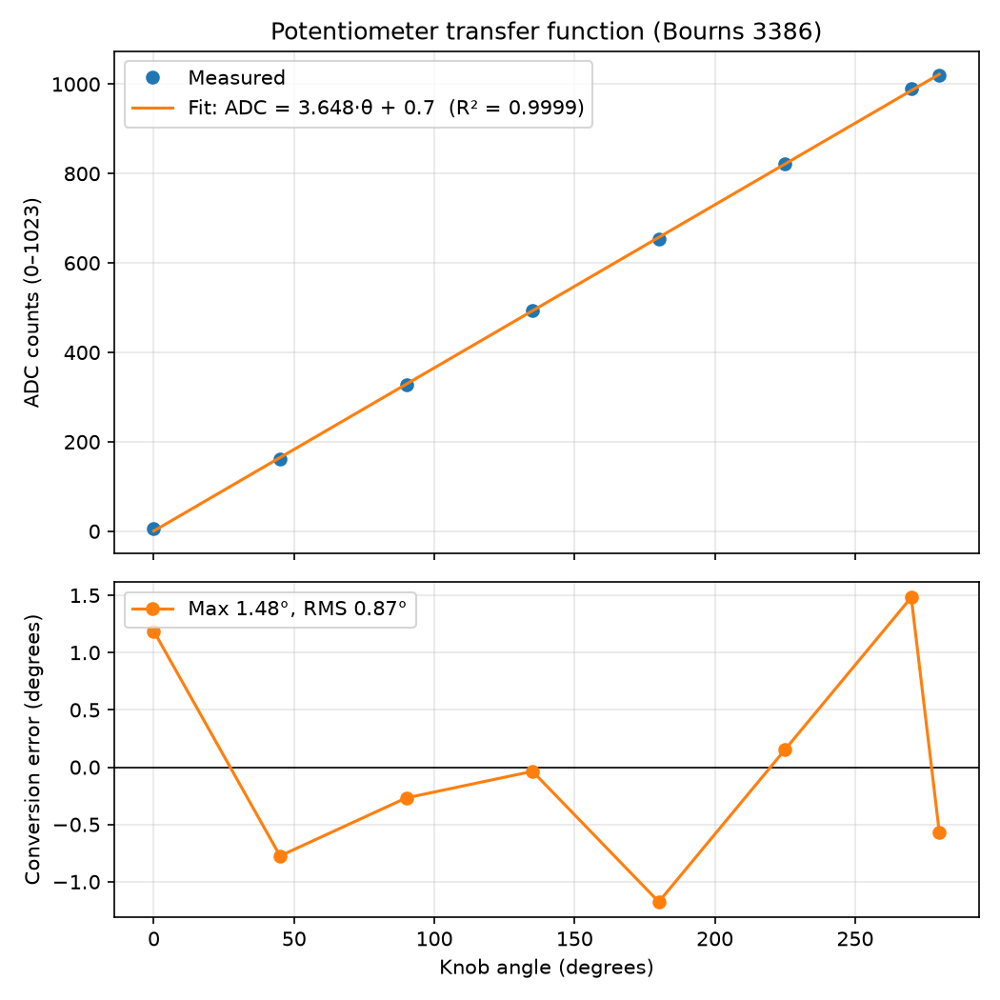
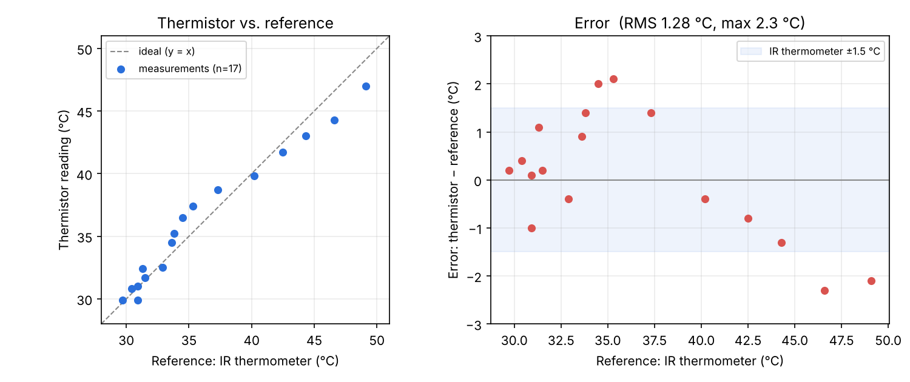

# fireflight-smcl
FireFlight Sensors &amp; Motor Control Lab

*SENSORS:*

**Potentiometer:**
- `smcl/pot.ino`: reads from A0, converts ADC counts to degrees
- `smcl/stepper.ino`: STEP/DIR driver with absolute moves (when controlled by sensor) and relative moves (when controlled by GUI)

_Transfer function_:
Raw counts were measured by placing a folded paper dial (45 degree increments) under the knob and recording the reading at each mark. The best-fit line was calculated from these points as ADC = 3.649 × angle + 0.3 (R² = 0.99991). 

- Measured electrical travel: 280.2° (datasheet: 280°)
- Measured error: max 1.47°, RMS 0.90° (most of this is probably measurement error)
- Since a pot is a resistive voltage divider with no dynamics, its transfer function is just a gain (3.649 counts / degree - same as slope from best fit line)

**Thermistor:**
- `smcl/thermistor.ino` / `smcl_integrated`: 10 kΩ NTC (Vishay NTCLE100E3103JB0) on A3, 10 kΩ pull-up to 5 V. 16 ADC samples averaged; ADC → resistance → β equation → °C. Drives the servo in sensor mode.

_Calibration & error_:
β was fitted against an IR thermometer (±1.5 °C) on 6 points (25–45 °C): β = 3220 (datasheet: 3977). It was then validated on 17 independent points over 30–49 °C, read from the GUI:

- Measured error: RMS 1.3 °C, max 2.3 °C, mean bias +0.1 °C
- The residual follows the cooling curve (thermistor reads high around 35 °C and low around 47 °C), which points to timing lag between the thermistor bead and the IR surface reading. Most points fall within the reference's own ±1.5 °C.

**TOF & ultrasonic sensors:**
Scene classification (Clear, Smoke, Transparent, Solid) using Ultrasonic and TOF sensor (based on https://arxiv.org/pdf/2510.06518 )

| Ultrasonic | ToF | Scene |
|---|---|---|
| far | far | CLEAR |
| near | near | SOLID |
| near | far/no valid echo | TRANSPARENT |
| far | near | SMOKE |

- **"Near"** = closer than 300 mm. A ToF reading only counts if the sensor marks it valid (range status 0).
- **Filtering:** exponential moving average on both sensors.

- Error Measurement (Ultrasonic Sensor)

- Error Measurement (TOF Sensor)

**Slot sensor:**
Omron EE-SX1042 on D12. Each beam break is counted and converted to RPM over a 1 s window, assuming 3 blades per revolution (true RPM = passes/s × 20).

_Measured error_: tested by hand, passing a cardboard through the slot in time with a metronome, up to 5 passes/s (the fastest we could do without a rotor).

| Passes/s | True RPM | GUI RPM | Error (RPM) |
|---|---|---|---|
| 1 | 20 | 20 | 0 |
| 2 | 40 | 40 | 0 |
| 3 | 60 | 60 | 0 |
| 4 | 80 | 80 | 0 |
| 5 | 100 | 100 | 0 |

- No missed counts at any tested rate
- RPM resolution is 20 RPM (60 / (3 blades × 1 s window)), so a pass landing on the window edge shifts the reading by one step
- Speeds above 100 RPM are untested

**Ultrasonic sensor:**

The UI's bottom-right row shows smoke detection on the left and **Control Mode**
on the right. In `smcl_integrated`, the debounced button on digital 13 toggles
between **Sensor Control** (startup) and **UI Control**. The `UIMode` sensor
accepts `REQ:UIMODE\n` in either mode and replies with `UIMODE:0\n` for sensor
control or `UIMODE:1\n` for UI control. Comms publishes `std_msgs/Bool` on
`ui_mode` (`true` means UI control); the display shows `—` until a reply arrives.

Ultrasonic telemetry uses raw 10-bit ADC counts: `REQ:ULTR\n` replies with
`ULT:<ADC>\n`. With the MaxSonar scaling assumed by this project (Vcc/512 volts
per inch and ADC reference equal to Vcc), distance is `ADC / 2` inches or
`ADC × 0.0127` meters. For example, ADC 100 displays 1.27 m. The Arduino keeps
a separate filtered millimeter value for its sensor control logic.

### INDIVIDUAL CONTRIBUTIONS & CHALLENGES:
#### Sadhana Kumar 
- _Contributions_: Implemented potentiometer reading and ADC-to-angle conversion and integrated the serial request handler for the comms node. Implemented a non-blocking STEP/DIR stepper driver for the EasyDriver so the potentiometer angle and the stepper angle are linked (pot can be used to change the angle of the stepper). Also measured the pot's transfer function with a paper angle dial at 45 degree increments and plotted this along with the measurement error. Wired and tested the pot, EasyDriver, and stepper on the bench supply. Added reporting of the stepper's actual angle moved for GUI commands.
- _Challenges_: Calibration errors from a slipping pointer (initial attempts gave readings at only 70% of the dial angles because the paper pointer was twisting on the knob. This was fixed by taping the pointer all the way around the knob and by checking for ~165 counts per 45 degrees while measuring. Also, the EasyDriver's LED stayed off even while other parts of the circuit had power / LEDs on; I traced the 12V supply voltage step by step using the multimeter and found that the other driver's lit LED had been lit by the Arduino's USB power, not the 12V rail as assumed. This helped deduce that the wires clipped to the banana plugs had come undone. 

#### Joel Milla
- I worked on wiring and integrating the slot sensor (Omron EE-SX1042), which was my first time working with a breadboard and electrical components, so a significant part of my contribution was learning how to read a sensor datasheet and translate it into a correct circuit. Although the slot sensor only required four connections (power, ground, signal output, and a pull-up/current-limiting resistor), and understanding why each connection was needed.I connected the sensor to the Arduino’s digital input pin, and converted the raw digital signal into a derived physical quantity (RPM/event count) as required by the lab spec.

Challenges
- I spent about three hours debugging the board because the arduino was not reading whether the slot was open or blocked. The symptom was that the sensor output never changed state regardless of whether the beam was broken. I used a multimeter to check for continuity and voltage drop across the circuit and was able to find that the resistor being used had too high resistance whcih limited the current causing the output to never reached the arduino. This taught me that resistor selection isn’t just about preventing damage from excess current, it also has to supply enough current for the sensor’s output stage to function correctly.

#### Percy Wu
- I worked on the comms_node and the ui_node. The comms_node serves as a bridge between the Arduino's serial connection to the local ros network. It is responsible for requesting sensor readings and sending motor commands to the Arduino, as well as forwarding sensor readings to the ros network. The ui_node converts the sensor readings from raw values to actual measurements, stores them in a circular buffer, and displays the instantaneous values + plot of sensor measurement history to the user. It also enables the user to send commands to the Arduino for motor control by sending commands over the ros network which is then forwarded by the comms_node.

- Challenges: Trying to help my teammate find a working DC motor. Merge conflicts in git. Originally the idea was to send the raw slot sensor value and then calculate the effective "RPM" from the ui node, but then we realized at 5Hz it was not fast enough to have high fidelity for the measurement, so we changed it to calculate the "RPM" from the Arduino and send that over instead. The old breadboard also had connection issues which made us think the pushbutton code was bad but it ended up just being a poor physical connection.

#### Malavika Mohan
- _Contributions_: Implemented the thermistor temperature sensing. The thermistor is read through a voltage divider on an analog pin; multiple ADC samples are averaged to reduce noise, and the result is converted to resistance and then to °C using the β model. Added the thermistor's serial request handler so the comms node can poll its readings, and implemented the sensor mode in which temperature sets the servo angle. Calibrated the thermistor against an IR thermometer, fitting a β value that matched our setup better than the datasheet value, and validated it on 17 independent points between 30 and 49 °C (RMS error 1.3 °C, max 2.3 °C). Applied the calibrated β in both the GUI and the integrated Arduino sketch.
  
- _Challenges_: Calibration was mostly a logistics problem. To get the thermistor into water it had to come off the breadboard onto extension wires, and the loose jumper joints on its thin leads caused an open circuit that read as −70 °C (ADC ≈ 1021, i.e. A3 pulled to 5 V). The bare leads also can't touch water without current leaking through it, so I first used a plastic bag, which slowed the thermistor's response, and later dipped only the epoxy bead. Without ice or a working heat source, the range was limited to a cooling mug of hot water (~30–49 °C), and the IR gun only reads the water surface, so the reference and the thermistor didn't always agree at the same moment. This shows in the error plot (reading high around 35 °C, low around 47 °C) and is the likely reason the fitted β is lower than the datasheet value. Separately, the servo's 1000–2000 µs mapping was labelled 0–180° but physically moved only ~100°, so I remapped it to the datasheet-rated 0–90° in both the Arduino and the GUI.
#### Nikunj Gupta
- I worked on the ultrasonic sensor and used it to control the DC motor RPM through PID. The ultrasonic sensor detects the obstacle distance. If the obstacle is beyond 1m, then the motor will rotate at 60 RPM. If the distance is less than 150 mm, the motor will rotate at 5 RPM. Between 150mm and 1m, the motor RPM is linearly scaled. The motor’s encoder value is used to measure its actual RPM and then a PID algorithm is used to modulate the PWM value and achieve the desired RPM on the DC motor.
  
- Challenges: 
1. While wiring the sensor and trying to run the DC motor, the motor was not moving. We rechecked all the wirings, replaced motor driver but still the problem stayed the same (sometimes the motor ran and sometimes it didn’t). We spent a lot of time thinking that it was a wiring or a component issue. We later realized that our DC motor was faulty (either a lot of friction or some faulty gears; Atirav helped us in figuring this out). When the motor shaft was rotated forcefully using a plier, it started running and then stopped, confirming that the problem was with the motor. This also explained why the motor was extracting a lot of current and causing the motor driver to heat up (more torque requirement -> more current demand).
2. During the process of tuning the PID (by borrowing the DC motor from another team), we made significant changes in the code. After that the motor shaft was rotating but with jerk. We initially thought that this motor had also started malfunctioning. To confirm that it was a hardware issue, we ran the old code and realized that with the old code it was working fine. Hence, it was software and not a hardware issue. The issue was that the proportional gain was too high (Kp) in the new code. This caused the RPM to jump instantly. High gain caused high fluctuations and explained the jerky behavior. The issue was resolved by keeping the Kp low and integral gain high which gradually helped the motor in achieving the desired RPM without taking sudden big steps.

#### Suhani Grover
- _Contributions_: I worked on the ToF and ultrasonic sensors, including soldering and wiring it. Using the two sensors, I implemented a simple scene classification algorithm (for clear/solid/transparent/smoke) based on the glass detection idea in arXiv:2510.06518 , that is, sound reflects of the glass while light passes through, and smoke does the opposite so the two sensors' disagreement tells us what is directly in front. I added a 3-reading confirmation so it doesn't flicker due to noisy value from the sensors. I also wrote the file for calibration of both sensors.  
- _Challenges_: The ToF kept giving issues while communicating to the arduino but this was solved after resoldering and realising it was due to poor contact. In the integrated code run, the DC motor ran in bursts and appeared to be damaged. For a while we thought it was a hardware issue, but it turned out to be a mismatched encoder constant (90 vs 420 counts per revolution). We also had to swap the Solarbotics motor driver for an L298N.
